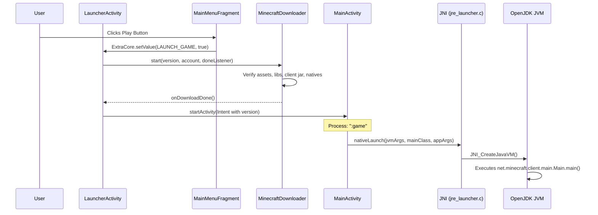

# VYRON Architecture Audit Report

**Date:** October 2026  
**Product:** VYRON — *Your Minecraft. Your World.*  
**Lead Architect & Systems Engineer:** Antigravity / Engineering Team  

---

## 1. Repository & Build Structure

```text
k:\VYRON LAUNCHER\
├── .agents/
├── .github/workflows/android.yml
├── .gitignore
├── .gitmodules
├── build.gradle (Root)
├── settings.gradle (Root)
├── gradle.properties
├── local.properties
├── gradlew / gradlew.bat
├── gradle/
│   ├── prefab_bypass.gradle
│   └── wrapper/gradle-wrapper.properties (Gradle 9.6.1)
├── docs/ (VYRON Specifications & Baseline)
├── app_pojavlauncher/ (Main Android App Module)
├── jre_lwjgl3glfw/ (GLFW Desktop Bridge Layer)
│   ├── lwjgl-3.3.3/
│   └── lwjgl-3.4.1/
├── forge_installer/ (Headless Forge/NeoForge Installer)
├── arc_dns_injector/ (DNS Cache & Injection Agent)
├── androidnsbypass/ (Android Linker Namespace Bypass)
└── MioLibPatcher/ (Runtime Library Patcher)
```

---

## 2. Module & Technology Matrix

| Attribute | Concrete Finding | Notes & Verification |
| :--- | :--- | :--- |
| **Root Project Name** | `VYRON-Launcher` | Configured in `settings.gradle` |
| **Application Module** | `:app_pojavlauncher` | Primary Android application |
| **Application ID** | `com.vyron.launcher` | `com.vyron.launcher.debug` for debug builds |
| **Namespace** | `net.kdt.pojavlaunch` | Preserves package-internal reflection / JNI symbol compatibility |
| **Min SDK** | `21` | Android 5.0 (Lollipop) |
| **Target SDK** | `35` | Android 15 (Google Play Store 2025/2026 compliant) |
| **Compile SDK** | `35` | Android 15 |
| **AGP Version** | `9.3.1` | Android Gradle Plugin |
| **Gradle Version** | `9.6.1` | Configured in `gradle/wrapper/gradle-wrapper.properties` |
| **Java Version** | Java 8 (source/target for app compatibility) / JVM 17 compile daemon | OpenJDK 17 used for toolchain |
| **NDK Version** | `28.2.13676358` | Verified installed in `D:\android-sdk\ndk\28.2.13676358` |
| **UI Technology** | Classic Android Views + XML + Custom Widgets | ViewBinding disabled, programmatic find/bind, custom views (`ExtendedButton`, `MineButton`, `mcVersionSpinner`, `mcAccountSpinner`) |
| **Compose Presence** | None currently present | Existing launcher uses XML ConstraintLayouts & Fragments |

---

## 3. Minecraft Launcher Engine Pipeline

### 3.1 Launch Sequence



### 3.2 Key Engine Subsystems

1. **Authentication (`net.kdt.pojavlaunch.authenticator`):**
   - Microsoft OAuth 2.0 flow (`MicrosoftBackgroundLogin.java`, `MicrosoftLoginFragment.java`).
   - Local offline accounts (`LocalLoginFragment.java`, `MinecraftAccount.java`).
   - Saved accounts serialized to JSON inside app private storage.
2. **Version & Profile Management (`net.kdt.pojavlaunch.value.launcherprofiles`):**
   - Implements standard Mojang `launcher_profiles.json` format (`LauncherProfiles.java`).
   - Tracks selected profile, lastVersionId, custom resolution, JVM arguments, and Java runtime override.
   - Remote version manifest fetched via `AsyncVersionList.java` from Mojang version API.
3. **Download Pipeline (`net.kdt.pojavlaunch.tasks`):**
   - `MinecraftDownloader.java` / `AsyncMinecraftDownloader.java`.
   - Downloads version JSON, parses libraries, assets index, client jar, and downloads concurrently with SHA-1 validation.
   - Extracts native `.so` / `.dll` libraries to private internal storage.
   - Progress reported via `ProgressKeeper.java` to `ProgressLayout.java`.
4. **Runtime & JNI Bridge (`src/main/jni`):**
   - `jre_launcher.c`: Uses `dlopen` to load `libjvm.so`, configures JVM classpath, invokes `JNI_CreateJavaVM`, and calls `main()`.
   - `input_bridge_v3.c`: Captures Android motion/touch/key events and feeds them to GLFW `CallbackBridge.java`.
   - `egl_bridge.c` & `gl_bridge.c`: Manages EGL display, contexts, and surface configuration.
   - Graphics backends: ANGLE (OpenGL ES to Vulkan/GLES), MobileGlues, and Zink (OpenGL over Vulkan).
5. **In-Game Touch Controls (`net.kdt.pojavlaunch.customcontrols`):**
   - `ControlLayout.java` overlays the game surface.
   - Deserializes control layout JSON (`default.json`).
   - Custom draggable buttons (`ControlData.java`), touchpad mouse emulation (`Touchpad.java`), hotbar quick select (`HotbarView.java`), virtual keyboard (`TouchCharInput.java`).
   - In-game controls editor in `CustomControlsActivity.java`.
6. **Storage & Scoped Storage (`net.kdt.pojavlaunch.scoped`):**
   - `FolderProvider.java`: Extends `DocumentsProvider` to expose `.minecraft` and control files to external file managers via Storage Access Framework (SAF).
   - Authority: `com.vyron.launcher.scoped.gamefolder`.

---

## 4. Dependencies & Precompiled Binaries

### Precompiled AARs in `app_pojavlauncher/libs`:
- `MobileGlues-release.aar`: Mobile OpenGL-to-Vulkan translation runtime.
- `SDL-release.aar`: Simple DirectMedia Layer backend.
- `SimpleFPEWrapper-release.aar`: Floating-point exception handling.
- `angle-release.aar`: Google ANGLE hardware acceleration.
- `imgui-java-release.aar`: Dear ImGui integration for debug overlays.
- `kopper-zink-release.aar`: Mesa Zink OpenGL-on-Vulkan driver.
- `lwjgl-3.3.3-natives-release.aar` & `lwjgl-3.4.1-natives-release.aar`: Native GLFW, OpenAL, OpenGL binaries.
- `openal-soft-release.aar`: 3D positional audio.
- `spirv-cross-natives.aar`: Shader compilation.
- `zstd-jni-release.aar`: High performance decompression.

---

## 5. Security & Isolation Findings
- The game runs in a separate process (`process=":game"`) specified in `AndroidManifest.xml` to prevent any JVM crashes from tearing down the launcher process.
- The GUI installer runs in `process=":gui_installer"`.
- Background persistent game sessions are guarded by `GameService` using `FOREGROUND_SERVICE_SPECIAL_USE`.
