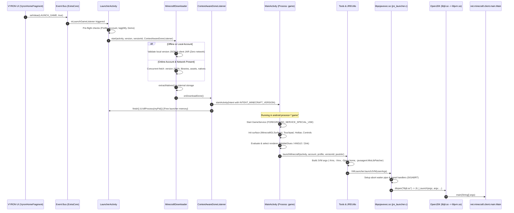

# VYRON Architecture Specification: Engine Boundary & Foundation Preservation

**Document Version:** 1.0.0  
**Phase:** Phase 1 (Engine Baseline / Foundation Preservation)  
**Target Module:** `:app_pojavlauncher`  
**Application ID:** `com.vyron.launcher`  
**Android Namespace:** `net.kdt.pojavlaunch`  
**Target Branch:** `v3_openjdk`  

---

## 1. Executive Summary & Core Architectural Principle

VYRON is a modernized, cloud-capable Minecraft Java Edition launcher platform built upon the high-performance PojavLauncher/Amethyst runtime lineage. The architectural foundation of VYRON adheres to a non-negotiable core principle:

> **The Engine Isolation Principle:**  
> The underlying Minecraft Java runtime and native engine—comprising the JNI bridge, OpenJDK JVM execution environment, LWJGL 3 windowing/input system, graphics translation layer (MobileGlues, ANGLE, Mesa Zink), and separate `:game` execution process—remains pristine, uncorrupted, and autonomous.  
>  
> Local game data (`launcher_profiles.json`, installed versions, assets, runtimes, worlds) remains strictly authoritative on the device. Offline gameplay must never be blocked or degraded by network unavailability or backend outages. Authentication credentials (notably Microsoft OAuth tokens) remain strictly on-device in hardware-backed Android KeyStore storage and are never transmitted to VYRON backend services.

This document formally defines the concrete subsystem boundaries, detailed execution call paths, native linkage requirements, and security guarantees governing Phase 1 and all subsequent implementation phases.

---

## 2. Complete Launch Call Path & Execution Flow

The transition from a user pressing "PLAY" to the execution of `net.minecraft.client.main.Main` traverses eight distinct, well-defined stages across the VYRON Product Layer, the Bridge Layer, the Android Application Engine, and the Native JNI/C++ Subsystem.



### 2.1 Detailed Stage Analysis

#### Stage 1: User Initiation (VYRON UI)
- **Source:** [`VyronHomeFragment.java`](file:///k:/VYRON%20LAUNCHER/app_pojavlauncher/src/main/java/com/vyron/ui/home/VyronHomeFragment.java#L80-L85) / [`MainMenuFragment.java`](file:///k:/VYRON%20LAUNCHER/app_pojavlauncher/src/main/java/net/kdt/pojavlaunch/fragments/MainMenuFragment.java#L9-L15)
- **Action:** User taps the primary "PLAY GAME" button.
- **Verification:** The UI verifies an active profile is selected via `VyronInstancesRepository.getActiveProfile()` and an account is present. If no account is logged in, the button acts as "CONNECT ACCOUNT" and redirects to `SelectAuthFragment`.
- **Trigger:** Dispatches event via `ExtraCore.setValue(ExtraConstants.LAUNCH_GAME, true)`.

#### Stage 2: Event Dispatch & Bridge
- **Component:** [`ExtraCore.java`](file:///k:/VYRON%20LAUNCHER/app_pojavlauncher/src/main/java/net/kdt/pojavlaunch/extra/ExtraCore.java)
- **Role:** Thread-safe, decoupling event hub. Decouples the presentation layer from the activity lifecycle.
- **Handling:** Registered listener `mLaunchGameListener` inside `LauncherActivity` receives the execution request.

#### Stage 3: Pre-flight Verification & Environment Preparation
- **Component:** [`LauncherActivity.java`](file:///k:/VYRON%20LAUNCHER/app_pojavlauncher/src/main/java/net/kdt/pojavlaunch/LauncherActivity.java#L179-L268)
- **Checks Executed:**
  1. **Concurrent Process Check:** `ProgressLayout.hasProcesses()` prevents launching while downloads, modpack installs, or runtime extractions are in progress.
  2. **Profile Validation:** Reads `LauncherPreferences.PREF_KEY_CURRENT_PROFILE`. Validates existence in `LauncherProfiles.mainProfileJson.profiles`.
  3. **Account Validation:** Ensures `mAccountSpinner.getSelectedAccount()` is non-null. If null, dispatches `ExtraConstants.SELECT_AUTH_METHOD`.
  4. **LWJGL3ify Detection:** Detects `lwjgl3ify-3` mod jar presence. If present and not yet configured, automatically injects patched version JSON and validates client assets.
  5. **Demo Account Restriction:** Verifies that demo accounts only run supported vanilla releases (>= 1.3).
  6. **Version Normalization:** Normalizes version string via `AsyncMinecraftDownloader.normalizeVersionId(prof.lastVersionId)`.

#### Stage 4: Asset & Dependency Preparation
- **Component:** [`MinecraftDownloader.java`](file:///k:/VYRON%20LAUNCHER/app_pojavlauncher/src/main/java/net/kdt/pojavlaunch/tasks/MinecraftDownloader.java#L74-L175)
- **Offline / Local Guarantee:**
  ```java
  if(isLocalProfile || !isOnline) {
      // Direct local file validation: zero network queries
      File providedJsonFile = new File(Tools.DIR_HOME_VERSION + "/" + realVersion + "/" + realVersion + ".json");
      // Verify integrity and notify listener immediately
      listener.onDownloadDone();
  }
  ```
- **Online Pipeline:**
  - Concurrently resolves Mojang version JSON, library artifacts, asset indexes, and client jar.
  - Multi-threaded download pool (4 worker threads) with SHA-1 validation.
  - Extracts native binaries (`.so`, `.dll`) into the version's private native library directory (`extractNatives`).
  - Streams progress to UI via `ProgressLayout.DOWNLOAD_MINECRAFT`.

#### Stage 5: Process Transition & Memory Reclaim
- **Component:** [`ContextAwareDoneListener.java`](file:///k:/VYRON%20LAUNCHER/app_pojavlauncher/src/main/java/net/kdt/pojavlaunch/lifecycle/ContextAwareDoneListener.java#L45-L54)
- **Execution:**
  - Instantiates `Intent` targeting [`MainActivity.class`](file:///k:/VYRON%20LAUNCHER/app_pojavlauncher/src/main/java/net/kdt/pojavlaunch/MainActivity.java) with `INTENT_MINECRAFT_VERSION`.
  - Dispatches `activity.startActivity(gameStartIntent)`.
  - Calls `activity.finish()` followed immediately by `android.os.Process.killProcess(android.os.Process.myPid())`.
  - **Critical Architectural Rationale:** On mobile devices with constrained RAM (4GB–8GB), killing the launcher process completely reclaims ART runtime heap and prevents Android OOM killer from terminating the subsequent `:game` process.

#### Stage 6: Game Process Initialization
- **Component:** [`MainActivity.java`](file:///k:/VYRON%20LAUNCHER/app_pojavlauncher/src/main/java/net/kdt/pojavlaunch/MainActivity.java#L125-L501)
- **Process Isolation:** Manifest declares `android:process=":game"` with hardware acceleration.
- **Initialization Sequence:**
  1. Starts [`GameService.java`](file:///k:/VYRON%20LAUNCHER/app_pojavlauncher/src/main/java/net/kdt/pojavlaunch/services/GameService.java) as a foreground service using `FOREGROUND_SERVICE_SPECIAL_USE` to maintain wake lock and process priority.
  2. Sets up layout [`activity_basemain.xml`](file:///k:/VYRON%20LAUNCHER/app_pojavlauncher/src/main/res/layout/activity_basemain.xml) including `MinecraftGLSurface`, `Touchpad`, `HotbarView`, and `ControlLayout`.
  3. Loads Minecraft options from disk via `MCOptionUtils.load()`.
  4. Configures input bridges (`CallbackBridge.addGrabListener`).
  5. Selects graphics renderer (`Tools.LOCAL_RENDERER`: `opengles_mobileglues`, `opengles_angle`, `opengles_zink`, or `opengles_system_gles`).
  6. Dispatches to `Tools.launchMinecraft`.

#### Stage 7: Java VM Construction & Environment Configuration
- **Components:** [`Tools.java`](file:///k:/VYRON%20LAUNCHER/app_pojavlauncher/src/main/java/net/kdt/pojavlaunch/Tools.java#L500-L551) & [`JREUtils.java`](file:///k:/VYRON%20LAUNCHER/app_pojavlauncher/src/main/java/net/kdt/pojavlaunch/utils/JREUtils.java#L334-L428)
- **Configuration Actions:**
  - Resolves JRE home via `MultiRTUtils.getRuntimeHome(runtime.name)`.
  - Relocates library paths and sets environment variables (`LD_LIBRARY_PATH`, `SDL_OPENGL_LIBRARY`, `SDL_EGL_LIBRARY`).
  - Purges problematic user args (`-Xms`, `-Xmx`, `-d32`, `-d64`, `-XX:+UseLargePages`, etc.).
  - Injects required system arguments:
    - `-Xms` and `-Xmx` set to `LauncherPreferences.PREF_RAM_ALLOCATION`.
    - `-Dorg.lwjgl.opengl.libname=<graphicsLib>`.
    - `-Dorg.lwjgl.freetype.libname=<lwjglNativesDir>/libfreetype.so`.
    - `-Dorg.lwjgl.spvc.libname=spirv-cross-c-shared`.
    - `-Dorg.lwjgl.system.allocator=system`.
    - `-XX:ActiveProcessorCount=<availableProcessors>`.
    - `-javaagent:<DIR_DATA>/MioLibPatcher/MioLibPatcher.jar`.
    - `-javaagent:<DIR_DATA>/arc_dns_injector/arc_dns_injector.jar=23.95.137.176` (if ARC capes enabled).
  - Invokes `chdir(gameDirectory)` to root file I/O in `.minecraft`.
  - Calls `VMLauncher.launchJVM(userArgs)`.

#### Stage 8: Native JNI Execution
- **Components:** [`VMLauncher.java`](file:///k:/VYRON%20LAUNCHER/app_pojavlauncher/src/main/java/com/oracle/dalvik/VMLauncher.java) & [`jre_launcher.c`](file:///k:/VYRON%20LAUNCHER/app_pojavlauncher/src/main/jni/jre_launcher.c#L184-L207)
- **Symbol:** `Java_com_oracle_dalvik_VMLauncher_launchJVM(JNIEnv *env, jclass clazz, jobjectArray argsArray)` in `libpojavexec.so`.
- **Execution Mechanism:**
  - Converts Java `String[]` to C `char** argv`.
  - Dynamically loads OpenJDK launcher library: `dlopen("libjli.so", RTLD_LAZY | RTLD_GLOBAL)`.
  - Resolves symbol `JLI_Launch`.
  - Configures signal tracking pipe (`abort_waiter_setup`) to trap `SIGABRT` and trigger user-friendly crash dialogs.
  - Calls `pJLI_Launch(margc, margv, ...)` which spawns OpenJDK, initialises HotSpot JVM, loads classes, and transfers control to `net.minecraft.client.main.Main.main()`.

---

## 3. Subsystem Decomposition & Concrete Boundaries

```text
+-----------------------------------------------------------------------------------+
|                            VYRON PRODUCT SUBSYSTEM                                |
|  - Modern Android 15 UI / Adaptive Shell (Bottom Nav & Nav Rail)                  |
|  - Home, Instances, Servers, Skins, More, Settings                               |
|  - Design System: VyronThemeController, Colors, Typography, Drawables             |
|  - Hardware-Backed KeyStore (AES-256-GCM Auth Storage)                            |
+-----------------------------------------------------------------------------------+
                                          |
                                          | Typed Interfaces & Data DTOs
                                          v
+-----------------------------------------------------------------------------------+
|                              VYRON BRIDGE SUBSYSTEM                               |
|  - VyronInstancesRepository <---> LauncherProfiles.mainProfileJson                |
|  - Event Bus Dispatches     <---> ExtraCore.setValue(LAUNCH_GAME, true)           |
|  - Preference Sync          <---> LauncherPreferences (RAM, Scale, Renderer)     |
|  - Auth State Sync          <---> PojavProfile / MinecraftAccount                 |
+-----------------------------------------------------------------------------------+
                                          |
                                          | Process Handoff (ContextAwareDoneListener)
                                          v
+-----------------------------------------------------------------------------------+
|                          MINECRAFT ENGINE SUBSYSTEM                               |
|  - LauncherActivity (Process & Download Orchestration)                            |
|  - MinecraftDownloader (Concurrent Mojang Hash Validation & Jar Preparation)      |
|  - In-Game Process: MainActivity (android:process=":game")                        |
|  - GameService (Foreground Service Special Use)                                   |
|  - In-Game Touch Controls: ControlLayout, Touchpad, HotbarView, Gyro              |
|  - Native JNI Core: libpojavexec.so, libexithook.so, libglxshim.so               |
|  - OpenJDK JRE Runtimes: JRE 8, 17, 21 (libjvm.so, libjli.so)                     |
|  - Graphics Translation: MobileGlues, ANGLE, Mesa Zink, GLFW CallbackBridge      |
+-----------------------------------------------------------------------------------+
```

### 3.1 Subsystem Matrix

| Subsystem | Components & Paths | Mutability | Isolation Rules |
| :--- | :--- | :--- | :--- |
| **Engine Subsystem** | `net.kdt.pojavlaunch.*`, `src/main/jni/*`, `activity_basemain.xml`, `ControlLayout.java` | **FROZEN / PROTECTED** | No package changes. No symbol alterations. No disruption of JNI/reflection. |
| **Product Subsystem** | `com.vyron.ui.*`, `res/layout/fragment_vyron_*`, `com.vyron.auth.*` | **ACTIVE REBUILD** | Implements VYRON Design System, Adaptive Shell, and secure account management. |
| **Bridge Subsystem** | `VyronInstancesRepository`, `ExtraCore`, `LauncherProfiles` adapters | **STRICT CONTRACT** | Clean unidirectional data access. Never bypasses disk serialization contracts. |
| **Storage Subsystem** | `.minecraft/`, `launcher_profiles.json`, `FolderProvider` (SAF) | **LOCAL AUTHORITATIVE** | Stored on local device filesystem. Never replaced or shadowed by cloud state. |
| **Security Subsystem** | `AndroidKeyStore`, `VyronKeyStoreHelper`, `EncryptedSharedPreferences` | **HIGH SECURITY** | Hardware AES-256-GCM. Microsoft tokens strictly isolated on-device. |
| **Renderer Subsystem** | MobileGlues, ANGLE, Zink, System GLES, `CallbackBridge` | **IMMUTABLE NATIVE** | Precompiled AARs linked as-is; environment variable orchestration via `JREUtils`. |

---

## 4. JNI Symbol & Package Preservation Rules

### 4.1 Base Namespace Invariant
The base package namespace for existing engine classes **MUST REMAIN `net.kdt.pojavlaunch`**. Under no circumstances should this namespace be renamed in Java, C, or build scripts.

**Technical Rationale:**
1. **Hardcoded JNI Export Names:** Native libraries (`libpojavexec.so`, `libexithook.so`) export symbols derived directly from the package name via the standard JNI calling convention:
   - `Java_net_kdt_pojavlaunch_utils_JREUtils_chdir`
   - `Java_net_kdt_pojavlaunch_MinecraftGLSurface_nativeSetSurface`
   - `Java_net_kdt_pojavlaunch_customcontrols_keyboard_LwjglCharSender_sendChar`
   - `Java_com_oracle_dalvik_VMLauncher_launchJVM`
2. **Third-Party Precompiled AARs:** Libraries such as `MobileGlues-release.aar`, `kopper-zink-release.aar`, and `lwjgl-*-natives-release.aar` invoke Java callback methods using static reflection lookups targeting `net.kdt.pojavlaunch.*`. Renaming the package results in fatal `ClassNotFoundException` and `UnsatisfiedLinkError` at game startup.
3. **Application ID vs. Package Name Separation:** Google Play identity is controlled independently by `applicationId "com.vyron.launcher"` in `app_pojavlauncher/build.gradle`. The Android Gradle Plugin decouples the manifest package/namespace (`net.kdt.pojavlaunch`) from the publication application ID (`com.vyron.launcher`).

---

## 5. Local Storage & Offline Gameplay Guarantees

1. **Local Authoritative Rule:**
   - The `.minecraft` directory located at `Tools.DIR_GAME_NEW` (internal private storage or SAF-accessible documents directory) is the single source of truth for:
     - Game profiles (`launcher_profiles.json`)
     - Downloaded version jars and metadata (`versions/<version>/`)
     - Shared game assets (`assets/indexes/`, `assets/objects/`)
     - Installed mods, modpacks, config files, and world saves (`saves/`, `mods/`)
2. **Zero Backend Dependency for Game Execution:**
   - The launcher must launch valid local profiles when:
     - The device is in Airplane Mode / has no network connectivity.
     - The VYRON backend is offline, unreachable, or returns HTTP 5xx errors.
     - The user is logged in with a local/offline profile.
3. **Storage Access Framework (SAF) Integrity:**
   - [`FolderProvider.java`](file:///k:/VYRON%20LAUNCHER/app_pojavlauncher/src/main/java/net/kdt/pojavlaunch/scoped/FolderProvider.java) exposes the `.minecraft` tree to external file managers via `com.vyron.launcher.scoped.gamefolder`.
   - Engine paths must never be hidden in inaccessible sandbox partitions that prevent manual mod or shaderpack installation.

---

## 6. Authentication & Security Boundary

1. **Dual Identity Separation:**
   - **Minecraft Identity:** Microsoft Account (MSA) OAuth 2.0 tokens (Access Token, Refresh Token, Minecraft Token, XSTS Token) or local offline profile.
   - **VYRON Platform Identity:** VYRON cloud account (JWT session tokens for cosmetics, server directory sync, and profiles backup).
2. **Strict Keystore Protection:**
   - All Microsoft authentication tokens are encrypted using the Android KeyStore provider with hardware-backed AES-256-GCM.
   - Secret keys are generated inside the device Secure Element / StrongBox (`AndroidKeyStore`) and never exportable.
   - Initialization vectors (IV) are 96-bit cryptographically secure random bytes generated per encryption operation.
3. **Data Boundary & Leak Prevention:**
   - Microsoft tokens, Xbox Live tokens, and Mojang session keys **MUST NEVER** be transmitted to VYRON servers, logged in crash reports, or included in telemetry payloads.
   - Backups and data extraction are explicitly disabled for sensitive credentials via `data_extraction_rules.xml` and `backup_rules.xml`.

---

## 7. Graphics & Native Renderer Subsystem

VYRON supports multiple hardware-accelerated rendering pipelines configured dynamically at launch:

```text
+---------------------------------------------------------------+
|                 Desktop OpenGL / LWJGL 3 Game                 |
+---------------------------------------------------------------+
                               |
                               v
+---------------------------------------------------------------+
|               Graphics Bridge Selection (JREUtils)            |
+---------------------------------------------------------------+
       |                       |                       |
       v                       v                       v
[MobileGlues]               [ANGLE]                 [Mesa Zink]
(GL-to-Vulkan translation)  (GLES to Vulkan/GLES)   (OpenGL over Vulkan)
       |                       |                       |
       +-----------------------+-----------------------+
                               |
                               v
+---------------------------------------------------------------+
|                     Vulkan / Native EGL                       |
+---------------------------------------------------------------+
                               |
                               v
+---------------------------------------------------------------+
|                      Mobile GPU Hardware                      |
|                  (Qualcomm Adreno, ARM Mali)                  |
+---------------------------------------------------------------+
```

1. **MobileGlues (`opengles_mobileglues`):** Default high-compatibility translation layer translating modern desktop OpenGL calls to Vulkan and GLES primitives.
2. **ANGLE (`opengles_angle`):** Google ANGLE translation engine providing conformant ES-to-Vulkan drivers.
3. **Mesa Zink (`opengles_zink`):** Full desktop OpenGL 4.6 implementation running atop Vulkan drivers (Mesa Turnip / proprietary Vulkan).
4. **System GLES (`opengles_system_gles`):** Direct hardware driver pass-through for legacy or optimized environments.

---

## 8. Verification & Sign-off Invariants (Phase 1 Gate)

Prior to exiting Phase 1 and commencing Phase 2, the following verification gates must be validated:

- [x] Complete call path from UI to OpenJDK `JLI_Launch` audited and documented.
- [x] Native shared library linkage (`libpojavexec.so`, `libexithook.so`, `libglxshim.so`) verified in `Android.mk`.
- [x] Package namespace preservation (`net.kdt.pojavlaunch`) confirmed.
- [x] Hardware keystore isolation for credentials validated.
- [x] Local storage authority and offline launch guarantees verified.
- [x] Clean compilation verified via `./gradlew :app_pojavlauncher:assembleDebug`.
