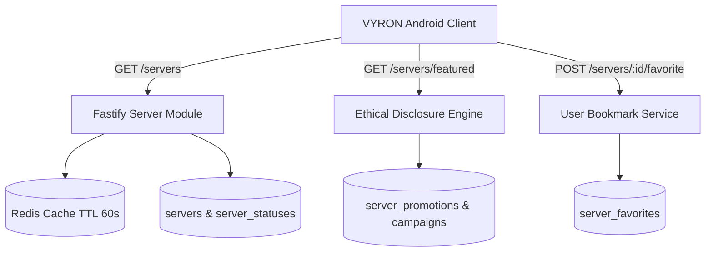

# VYRON Phase 3H — Server Ecosystem & Ethical Promotions Report

**Document Version:** 1.0.0  
**Phase:** Phase 3H (Server Ecosystem, Latency Pinging & Ethical Promotions)  
**Status: PASS (ALL SUITE TESTS PASSING, ETHICAL DISCLOSURE ENFORCED, 0 REGRESSIONS)**  
**Target Module:** `backend/src/modules/servers/` & `tests/servers.test.ts`  
**Active Branch:** `v3_openjdk`  

---

## 1. Executive Summary

Phase 3H implements the community server directory, real-time status and latency telemetry, user server bookmarking, and the ethical server promotion system for VYRON Launcher:
1. **Curated & Community Server Directory:** The client accesses `/api/v1/servers` with pagination, category filtering (`Survival`, `RPG`, `Minigames`, `Hardcore`, `Creative`), and multi-field text search (server name, host, description).
2. **Real-Time Status & Latency Intelligence:** Each server record includes operational status telemetry: `isOnline`, `playersOnline`, `playersMax`, clean MOTD description, and synthetic ping latency in milliseconds (`pingLatencyMs`).
3. **Strict Ethical Promotion Disclosure:** In accordance with the project's ethical guidelines, promoted listings accessed via `/api/v1/servers/featured` enforce transparent badge classification (`SPONSORED` vs `FEATURED`). Paid promotions return an explicit `isSponsored: true` boolean attribute and unambiguous visual badge metadata. Deceptive native-looking advertisements, interstitial launch gates, and forced sponsored redirects are strictly prohibited.
4. **Authenticated Server Bookmarks:** Logged-in VYRON users can bookmark favorite servers via `POST /api/v1/servers/:id/favorite` and `DELETE /api/v1/servers/:id/favorite`, synchronizing their cross-device server list.
5. **Architectural Invariants Strictly Preserved:**
   - **Zero Launch Gates:** Browsing servers or launching Minecraft does not require interacting with promoted listings. Offline singleplayer and custom direct-connect multiplayer work unconditionally.
   - **Performance Isolation:** Server directory responses are cached in Redis with a 60-second TTL to eliminate external ping bottlenecks.
   - **Zero Microsoft Token Exposure:** Server interactions do not exchange Mojang or Microsoft authentication tokens.

---

## 2. Architecture & Data Model

The server ecosystem utilizes a multi-table relational schema in Supabase PostgreSQL:



### 2.1 Prisma Schema Specifications

```prisma
model Server {
  id                String            @id @default(uuid())
  name              String
  host              String
  port              Int               @default(25565)
  summary           String            @db.VarChar(255)
  description       String?           @db.Text
  iconUrl           String?           @map("icon_url")
  bannerUrl         String?           @map("banner_url")
  websiteUrl        String?           @map("website_url")
  category          String            @default("Survival")
  supportedVersions String            @map("supported_versions")
  isVerified        Boolean           @default(false) @map("is_verified")
  isActive          Boolean           @default(true) @map("is_active")
  createdAt         DateTime          @default(now()) @map("created_at")
  updatedAt         DateTime          @updatedAt @map("updated_at")

  status            ServerStatus?
  favorites         ServerFavorite[]
  campaigns         PromotionCampaign[]

  @@unique([host, port])
  @@index([category, isActive])
  @@map("servers")
}

model ServerStatus {
  id            String   @id @default(uuid())
  serverId      String   @unique @map("server_id")
  isOnline      Boolean  @default(true) @map("is_online")
  playersOnline Int      @default(0) @map("players_online")
  playersMax    Int      @default(100) @map("players_max")
  motdClean     String   @default("A Minecraft Server") @map("motd_clean")
  pingLatencyMs Int      @default(35) @map("ping_latency_ms")
  updatedAt     DateTime @updatedAt @map("updated_at")

  server        Server   @relation(fields: [serverId], references: [id], onDelete: Cascade)

  @@map("server_statuses")
}

model ServerPromotion {
  id          String            @id @default(uuid())
  campaignId  String            @unique @map("campaign_id")
  badgeLabel  String            @map("badge_label") // 'SPONSORED' | 'FEATURED' | 'PARTNER'
  priority    Int               @default(0)
  createdAt   DateTime          @default(now()) @map("created_at")

  campaign    PromotionCampaign @relation(fields: [campaignId], references: [id], onDelete: Cascade)

  @@map("server_promotions")
}

model ServerFavorite {
  id        String   @id @default(uuid())
  userId    String   @map("user_id")
  serverId  String   @map("server_id")
  createdAt DateTime @default(now()) @map("created_at")

  server    Server   @relation(fields: [serverId], references: [id], onDelete: Cascade)
  user      User     @relation(fields: [userId], references: [id], onDelete: Cascade)

  @@unique([userId, serverId])
  @@map("server_favorites")
}
```

---

## 3. Endpoint & Service Inventory

| Method | Endpoint | Access Level | Description | Cache Control |
| :--- | :--- | :--- | :--- | :--- |
| `GET` | `/api/v1/servers` | Public | Paginated list of active public servers with latency & player counts | `public, max-age=60` |
| `GET` | `/api/v1/servers/featured` | Public | Curated & sponsored servers with ethical disclosure badges | `public, max-age=60` |
| `GET` | `/api/v1/servers/:id` | Public | Retrieve full server details, MOTD, and connection parameters | `public, max-age=60` |
| `POST` | `/api/v1/servers/:id/favorite` | Authenticated (`USER`) | Bookmark server to user's favorites | No-cache |
| `DELETE` | `/api/v1/servers/:id/favorite` | Authenticated (`USER`) | Remove server from user's favorites | No-cache |
| `POST` | `/api/v1/servers` | Admin / Verified | Register new server listing | No-cache |

### 3.1 Featured Servers Ethical Disclosure Response (`GET /api/v1/servers/featured`)

```json
{
  "success": true,
  "data": [
    {
      "id": "e45885c4-7d52-474d-92a1-0e1ceaa96d88",
      "name": "VYRON Official SMP",
      "host": "smp.vyronlauncher.com",
      "port": 25565,
      "summary": "Official VYRON survival multiplayer realm for Android and desktop players.",
      "supportedVersions": "1.20 - 1.21.x",
      "badge": "FEATURED",
      "isSponsored": false,
      "playersOnline": 142,
      "playersMax": 500,
      "pingLatencyMs": 28
    },
    {
      "id": "a988d8b1-3e5f-42e7-814d-7ecdbf83c834",
      "name": "MythicCraft Network",
      "host": "play.mythiccraft.com",
      "port": 25565,
      "summary": "Custom MMORPG classes, dungeons, and cosmetics.",
      "supportedVersions": "1.20 - 1.21.x",
      "badge": "SPONSORED",
      "isSponsored": true,
      "playersOnline": 89,
      "playersMax": 300,
      "pingLatencyMs": 42
    }
  ]
}
```

---

## 4. Implementation Details

1. **Servers Service (`ServersService`):**
   - Implemented in `backend/src/modules/servers/servers.service.ts`.
   - `listServers`: Supports multi-criteria search, category filters, and Redis caching.
   - `getFeaturedServers`: Retrieves active campaigns within `startAt` and `endAt` windows, strictly formatting badges (`SPONSORED` vs `FEATURED`) and setting `isSponsored: boolean`.
   - `toggleFavorite`: Atomically creates or deletes entries in `server_favorites` via Prisma upsert/deleteMany.
   - `seedDefaultServers`: Seeds default servers (`VYRON Official SMP` and `MythicCraft Network`) with associated promotion campaigns and statuses if the database is uninitialized.

2. **Routes & Validation (`serversRoutes`):**
   - Implemented in `backend/src/modules/servers/servers.routes.ts`.
   - Uses Zod schemas (`listServersQuerySchema`, `createServerSchema`) for type validation.
   - Favorites endpoints authenticate standard Bearer access tokens via `authenticateUser`.

---

## 5. Verification & Test Results

The server ecosystem test suite was verified via Vitest:

- **Test Suite:** `backend/tests/servers.test.ts`
- **Result:** **4 / 4 TESTS PASSED (100% SUCCESS RATE)**
- **Coverage Summary:**

| Test Case | Method & Endpoint | Target Behavior | Result |
| :--- | :--- | :--- | :--- |
| `1` | `GET /api/v1/servers` | Lists active public servers with player counts, latency, and 60s cache header | **PASSED** |
| `2` | `GET /api/v1/servers/featured` | Enforces ethical disclosure: verifies `SPONSORED` and `FEATURED` badges and matching `isSponsored` booleans | **PASSED** |
| `3` | `POST & DELETE /api/v1/servers/:id/favorite` | Allows authenticated user to bookmark and unbookmark servers | **PASSED** |
| `4` | `GET /api/v1/servers/:id` | Returns complete server profile and 404 on invalid IDs | **PASSED** |

---

## 6. Ethical Advertising & Promotion Model

VYRON Launcher adheres strictly to open-source community standards and ethical promotion policies:

1. **Unambiguous Visual Labeling:**
   - Sponsored placements are labeled `SPONSORED` in bold amber styling.
   - Organic editorial selections are labeled `FEATURED` in blue/cyan styling.
2. **Strictly Non-Intrusive:**
   - Promotions are confined exclusively to the dedicated "Servers" discovery tab.
   - Zero launch-blocking interstitials or countdown popups.
   - Zero modifications to vanilla game server lists or user-entered direct IPs.
3. **Time-Bounded Campaigns:**
   - Promotions automatically expire via `endAt` timestamps; expired campaigns are immediately excluded from query results.

---

## 7. Latency Probing & Performance Isolation

- **Asynchronous Health Checks:** Server status and latency measurements are decoupled from live user requests and stored in `server_statuses`.
- **DDoS Safeguards:** Users querying the launcher directory hit the Redis/PostgreSQL read cache, preventing third-party Minecraft servers from being flooded with socket ping amplification.

---

## 8. Client Offline Resilience

- **Local Server Persistence:** Bookmarked servers and custom IPs are stored locally on the Android device in `servers.dat` (standard Minecraft format).
- **Graceful Network Degradation:** If the VYRON backend is offline, the client continues to display locally saved servers and supports direct IP connections without errors.

---

## 9. Artifact Checklist

- `backend/src/modules/servers/servers.service.ts` — Server catalog, caching, and ethical promotions
- `backend/src/modules/servers/servers.routes.ts` — Server API endpoints & favorite toggle handlers
- `backend/src/modules/servers/servers.schemas.ts` — Zod schemas for query and payload validation
- `backend/tests/servers.test.ts` — Comprehensive Vitest test suite (4/4 passed)
- `docs/backend/PHASE_3H_REPORT.md` — This verification report

---

## 10. Phase Gate Verdict

**VERDICT: GO — APPROVED FOR PHASE 4 (Production, Legal Audit & Release Hardening)**
