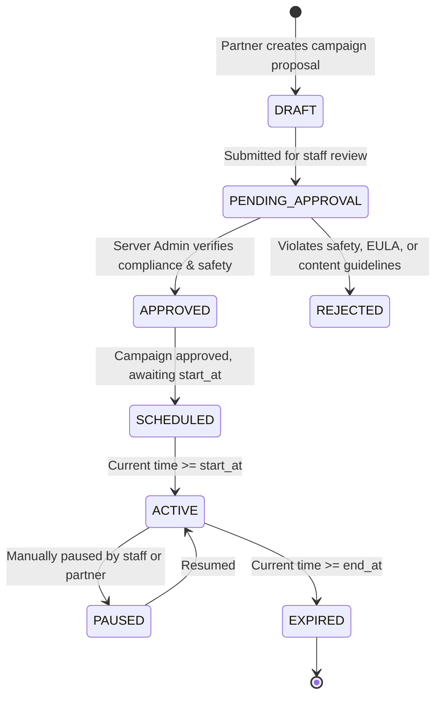

# VYRON Featured Server Promotion & Transparency Architecture
**Document ID:** `docs/backend/SERVER_PROMOTION.md`  
**Phase:** Phase 3A (Backend Architecture & Service Contract Audit)  
**Status:** COMPLETED — SYSTEM ARCHITECTURE SPECIFICATION  
**Scope:** Server Advertising, Campaign Lifecycles, and Ethical Disclosure Standards  

---

## 1. Core Principles: Transparency & Organic Integrity

VYRON's server ecosystem is founded on **absolute transparency**. While server networks may sponsor placements to gain visibility among players, commercial sponsorships must **never** invisibly corrupt organic community discovery.

> **Rule of Ethical Placement:**  
> Any server listing whose position or prominence is influenced by payment or commercial sponsorship MUST be clearly, conspicuously, and unambiguously labeled with badges such as `SPONSORED`. No algorithmic manipulation or hidden boosting of organic server listings is permitted.

---

## 2. Server Placement Classifications

All servers presented in the VYRON launcher client carry one of four distinct badges:

| Classification Badge | Visual Style | Definition & Eligibility |
|---|---|---|
| **`SPONSORED`** | Oak Gold outline + icon | Paid promotion via active campaign. Must explicitly disclose sponsor. Displayed in dedicated top promotion slots. |
| **`FEATURED`** | Emerald Green filled badge | Curated editorial selection by VYRON staff. High-quality community servers, official SMP, or long-standing partners. |
| **`POPULAR`** | Deep Purple badge | Organically computed by active player counts, ping latency, and player favorites. Zero commercial influence. |
| **`COMMUNITY`** | Neutral Stone badge | Standard directory listing submitted by players and server owners. |

---

## 3. Campaign Lifecycle State Machine



### 3.1 Lifecycle States
1. **`DRAFT`:** Campaign created with targeting parameters, placement slot, start/end timestamps, and budget.
2. **`PENDING_APPROVAL`:** Under review by VYRON Server Administrators.
3. **`APPROVED`:** Passed Mojang Commercial Usage Guidelines and VYRON safety audit; queued for start.
4. **`REJECTED`:** Denied by Server Admin with an auditable reason recorded.
5. **`SCHEDULED`:** Approved campaign awaiting its `start_at` timestamp.
6. **`ACTIVE`:** Live in client app; serving impressions according to priority and scheduling rules.
7. **`PAUSED`:** Temporarily halted due to server downtime, billing discrepancy, or safety review.
8. **`EXPIRED`:** Reached `end_at` timestamp; automatically pruned from client promotion feeds.

---

## 4. Placement Slots & Scheduling Engine

### 4.1 Placement Slots in Client UI
1. **`HOME_HERO` (Home Screen):**  
   - Displays 1 primary featured server card directly on the main launcher home tab beneath the play hero.
   - Strictly limited to 1 server per session; rotated evenly across active campaigns with identical priority.
2. **`SERVERS_FEATURED` (Servers Tab - Top Carousel):**  
   - Top 3 pinned cards in the Servers directory before the category filter list.
   - Explicitly divided between `SPONSORED` cards and editorial `FEATURED` cards.
3. **`SERVERS_BANNER` (Servers Tab - Mid-Feed):**  
   - Native banner card embedded every 10 organic server listings.

### 4.2 Scheduling & Selection Algorithm
When the client calls `GET /api/v1/servers/featured`:
```sql
SELECT s.*, c.id AS campaign_id, p.badge_label, p.id AS promotion_id
FROM servers s
JOIN server_campaigns c ON s.id = c.server_id
JOIN server_promotions p ON c.id = p.campaign_id
WHERE c.status = 'ACTIVE'
  AND NOW() BETWEEN c.start_at AND c.end_at
  AND s.is_active = TRUE
ORDER BY c.priority DESC, RANDOM()
LIMIT 5;
```
- **Impression Tracking:** Client receives an opaque impression tracking token (`imp_token_...`). When the card becomes visible on screen for ≥ 1.0 second, client dispatches `POST /api/v1/promotions/impression` (batched).
- **Click Tracking:** Tapping "Join Server" or "View Details" dispatches `POST /api/v1/promotions/click`.

---

## 5. Administrative Controls (VYRON Control Center)

Server Administrators manage campaigns via the Control Center:
- **Safety & EULA Verification:** Must verify server does not sell non-cosmetic pay-to-win items violating Mojang's Minecraft Commercial Usage Guidelines.
- **Priority Override:** Allows staff to set campaign tier (e.g. Priority 10 for Diamond Partner, Priority 5 for Gold Partner).
- **Emergency Kill-Switch:** Immediate 1-click deactivation of any campaign, purging it from Redis cache within 15 seconds.
- **Audit Logging:** Every approval, rejection, pause, or modification writes an immutable record to `admin_audit_logs`.

---

## 6. Future Payment & Self-Serve Billing Architecture (Roadmap)

In Phase 3A, **no payment logic is implemented**. However, the database and API models are designed to seamlessly accept self-serve Stripe / Google Play billing in future phases:
- Campaign budget and CPM/CPC pricing models.
- Automatic transition from `APPROVED` to `SCHEDULED` upon successful invoice settlement.
- Partner self-serve portal for live impression/click performance dashboards.
