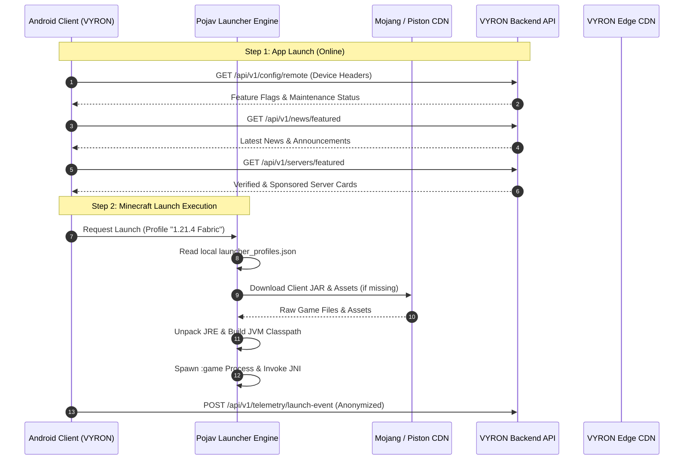

# VYRON Service Boundary & Responsibility Matrix
**Document ID:** `docs/backend/SERVICE_BOUNDARY.md`  
**Phase:** Phase 3A (Backend Architecture & Service Contract Audit)  
**Status:** COMPLETED — ARCHITECTURAL SPECIFICATION  
**Target Architecture:** Android Client (:app_pojavlauncher) ↔ VYRON Cloud Backend  

---

## 1. Core Architectural Principle

The cornerstone of the VYRON architecture is **absolute operational autonomy for local gameplay**:

> **Rule of Local Sovereignty:**  
> The Android launcher application MUST be capable of running, configuring, modding, and launching Minecraft Java Edition completely offline, without contacting the VYRON backend. The backend enhances the user experience with identity, community servers, curated news, compatibility profiles, and telemetry—it is NEVER a single point of failure for launching Minecraft.

```text
+-----------------------------------------------------------------------------------+
|                            VYRON ANDROID CLIENT                                   |
|                                                                                   |
|  [LOCAL ENGINE DOMAIN]                             [ONLINE PRODUCT DOMAIN]        |
|  - Process & JNI Bridge                            - Remote Config & News         |
|  - OpenJDK Execution                               - Server Directory / Featured  |
|  - Local Game Instances                            - VYRON User Profile           |
|  - Assets / Libraries / Client JARs                - Server Favorites Sync        |
|  - In-Game Controls & Virtual Mouse                - Compatibility Feeds          |
|  - Worlds, Mods, Resource Packs                    - Performance Telemetry        |
|  - Scoped Storage DocumentsProvider                - In-App Notifications         |
+-----------------------------------------------------------------------------------+
                                          |
                                    HTTPS / REST
                                          |
                                          v
+-----------------------------------------------------------------------------------+
|                             VYRON CLOUD BACKEND                                   |
|                                                                                   |
|  - Identity & OAuth2 Bridge                        - News & Announcement CMS      |
|  - Server Promotion & Verification Engine          - Release & Rollout Engine     |
|  - Minecraft Version Manifest Ingestion            - Feature Flag Management      |
|  - Device Compatibility Database                   - Admin RBAC & Audit Trails    |
|  - Anonymized Performance Ingestion                - Cloud Backup (Future)        |
+-----------------------------------------------------------------------------------+
```

---

## 2. Granular Responsibility Matrix

### 2.1 Local Launcher Responsibilities

| Responsibility Area | Authority | Description & Local Invariants |
|---|:---:|---|
| **Minecraft Launching** | **Client Exclusively** | Assembly of JVM command-line arguments, classpath construction, process spawning (`process=":game"`), and JNI invocation (`jre_launcher.c`). |
| **Java Runtime Execution** | **Client Exclusively** | Storage, extraction, and execution of internal and external OpenJDK tarballs (`Tools.MULTIRT_HOME`). |
| **Game Asset Management** | **Client Exclusively** | Parsing asset index JSONs, verifying SHA-1 digests, and streaming objects from Mojang CDN (`resources.download.minecraft.net`). |
| **Minecraft Libraries** | **Client Exclusively** | Resolution of OS/architecture dependencies and downloading JARs directly from Mojang and Maven Central. |
| **Client Game JARs** | **Client Exclusively** | Fetching release/snapshot client JARs directly from Mojang Piston CDN. |
| **Local Instances & Profiles** | **Client Exclusively** | Authoritative state stored in `.minecraft/launcher_profiles.json` via `LauncherProfiles.java`. Zero external DB dependence. |
| **In-Game Touch Controls** | **Client Exclusively** | Runtime input translation, touch layout rendering, and on-screen button maps (`default.json`, `ControlLayout.java`). |
| **Graphics & Rendering** | **Client Exclusively** | Native translation layers: ANGLE (Vulkan/GLES), Mesa Zink, MobileGlues, and SFPEW. |
| **Worlds & Save Files** | **Client Exclusively** | Authoritative reads/writes to `.minecraft/saves/`. Local disk integrity is paramount. |
| **Mods & Modloaders** | **Client Exclusively** | Loading Forge, Fabric, NeoForge, and Quilt bytecode mods inside the JVM process. |
| **Resource Packs & Shaders** | **Client Exclusively** | Local file extraction and in-game activation (`.minecraft/resourcepacks/`, `.minecraft/shaderpacks/`). |
| **Storage Access Framework** | **Client Exclusively** | Android DocumentsProvider (`FolderProvider.java`) exposing `.minecraft` to file explorers. |
| **Offline-First Resilience** | **Client Exclusively** | Seamless application startup and offline play when network connectivity is absent. |

---

### 2.2 Backend Responsibilities

| Responsibility Area | Authority | Description & Backend Scope |
|---|:---:|---|
| **VYRON User Identity** | **Backend Exclusively** | Registration, credential hashing (Argon2id), JWT issuance, refresh token rotation, and device session tracking. |
| **Cross-Device Profile Sync** | **Backend Exclusively** | Storing user preferences, linked Minecraft UUIDs, skin showcase, and favorite servers. |
| **News & Announcements CMS** | **Backend Exclusively** | Article authoring, Markdown storage, CDN asset distribution, scheduling, and urgent alert banners. |
| **Server Directory** | **Backend Exclusively** | Curated catalog of community and network servers, version tagging, category filtering, and online status pings. |
| **Featured Server Promotions** | **Backend Exclusively** | Commercial placement management, scheduled campaigns, impression/click counters, and transparent sponsored disclosures. |
| **Minecraft Version Indexing** | **Backend Exclusively** | Automated polling and normalization of Mojang Piston manifests, Forge/Fabric metadata, and library requirements. |
| **Compatibility Database** | **Backend Exclusively** | Crowd-verified and team-tested compatibility ratings (Device CPU/GPU + Renderer + Java Version + MC Version). |
| **Release Management** | **Backend Exclusively** | Distribution of VYRON launcher updates, APK hashes, changelogs, and staged percentage rollouts. |
| **Remote Config & Feature Flags** | **Backend Exclusively** | Dynamic runtime configuration toggles (e.g. enabling new renderers, emergency kill-switches, maintenance mode). |
| **Operational Telemetry** | **Backend Exclusively** | Ingestion of anonymized launch success rates, crash stack traces, FPS aggregates, and device distribution metrics. |
| **Administration & RBAC** | **Backend Exclusively** | Single unified control plane with role-based permissions and immutable audit logs. |
| **Cloud Backups (Future)** | **Backend Exclusively** | User-initiated encrypted backups of worlds, custom control layouts, and instance profiles. |
| **Subscriptions & Billing (Future)**| **Backend Exclusively** | Payment processing (Google Play Billing / Stripe), tier verification, and entitlement provisioning. |

---

## 3. Data Flow & Communication Contracts



---

## 4. Boundary Violation Guardrails

To prevent architectural drift during development, the following invariants are enforced:

1. **NO Heavy Asset Relaying:**  
   The VYRON backend MUST NOT proxy or cache vanilla Minecraft game JARs, sound files, or asset blobs. Clients fetch these directly from Mojang's official CDNs.
2. **NO Backend Dependency for Launch:**  
   The launcher engine MUST NOT make a synchronous network call to the VYRON backend on the critical path of spawning the Minecraft JVM process.
3. **NO Database Duplication:**  
   The client MUST NOT maintain a duplicate SQLite database mirroring `launcher_profiles.json`. `LauncherProfiles.java` remains the single local source of truth.
4. **NO Storage of Plaintext Secrets on Backend:**  
   The backend stores user passwords only as salted Argon2id hashes. Microsoft OAuth tokens generated on client devices MUST NEVER be transmitted to or stored on the VYRON backend.
